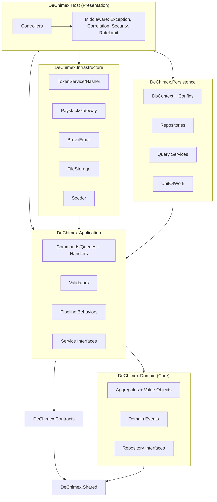
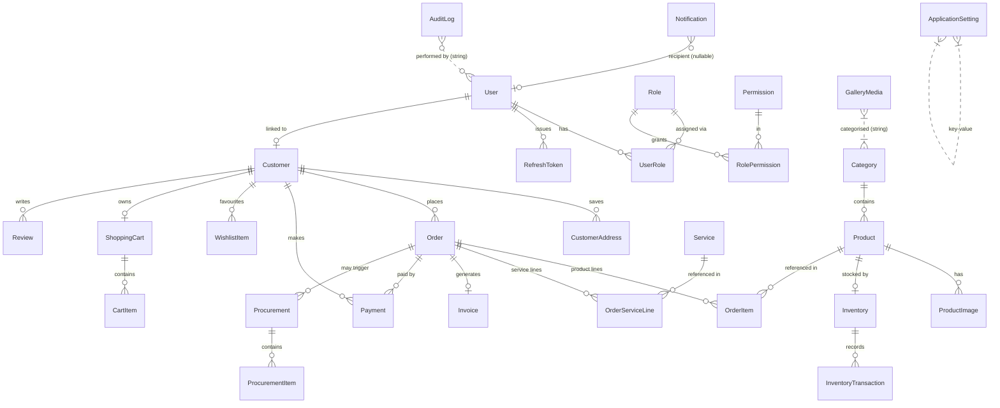
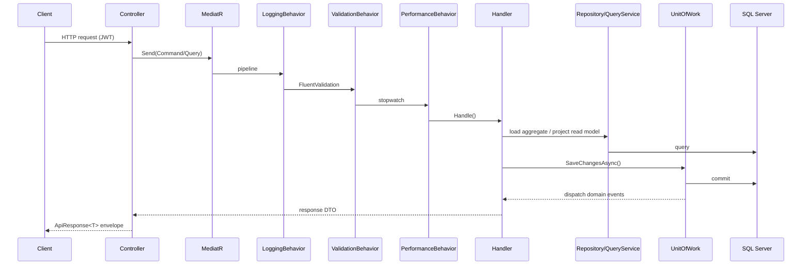
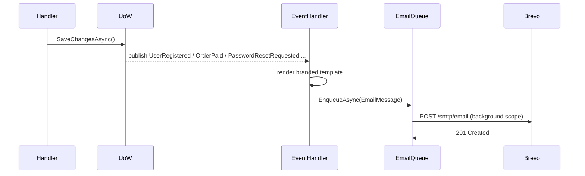
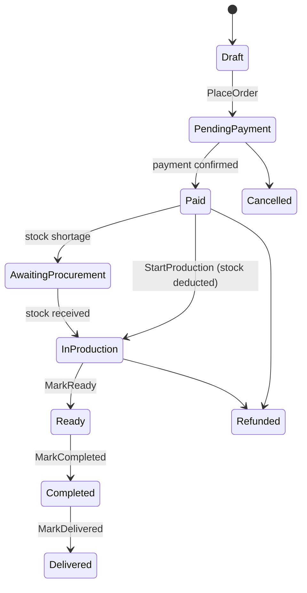

# 01 · Architecture & Flows

## 1. Solution architecture (Onion)



**Dependency rule:** arrows point inward. Domain has no outward dependencies.
Infrastructure & Persistence implement interfaces declared in Application/Domain (Dependency Inversion).

---

## 2. Database ER diagram



### Entity relationship explanation
- **Security:** `User` ↔ `Role` (many-to-many via `UserRole`), `Role` ↔ `Permission` (via `RolePermission`).
  A `User` may be linked to one `Customer` profile. `RefreshToken` stores only a **hash**.
- **Catalog:** `Category 1-* Product 1-* ProductImage`. Each `Product` has exactly one `Inventory`
  (1-1), and every stock change appends an `InventoryTransaction` (immutable ledger).
- **Sales:** `Order` owns `OrderItem` (products) **and** `OrderServiceLine` (services). One `Invoice`
  per order (1-1); an order may have many `Payment` attempts. `OrderType` (Inventory/Service/Mixed)
  is **derived** from the lines present.
- **Procurement:** `Procurement 1-* ProcurementItem`, optionally linked to a source `Order` to fulfil
  a backorder. Receiving increases stock via the `Inventory` aggregate.
- **Customer experience:** `ShoppingCart 1-* CartItem`, `WishlistItem`, `Review`.
- **System:** `Notification` (nullable recipient = staff broadcast), `AuditLog`, `ApplicationSetting`.

---

## 3. Request flow (CQRS pipeline)



---

## 4. Authentication flow (JWT + refresh rotation)

```mermaid
sequenceDiagram
    participant Client
    participant Api
    participant TokenService
    participant DB

    Client->>Api: POST /auth/login (email, password)
    Api->>DB: load user + roles
    Api->>Api: verify password (PBKDF2), check lockout/active
    Api->>TokenService: create access (JWT) + refresh token
    TokenService-->>Api: access (15m) + refresh (7d, hash stored)
    Api-->>Client: AuthResponse (accessToken, refreshToken)

    Note over Client,Api: access token expires
    Client->>Api: POST /auth/refresh (refreshToken)
    Api->>DB: find by token hash
    Api->>Api: validate active; ROTATE (revoke old, issue new)
    Api-->>Client: new access + refresh pair
    Note over Api: reuse of revoked token -> revoke ALL sessions
```

Access tokens carry `role` and `permission` claims; endpoints use
`[Authorize(Policy = Permissions.X)]` resolved by a dynamic `PermissionPolicyProvider`.

---

## 5. Payment flow (Paystack): inventory deducted only after payment

```mermaid
sequenceDiagram
    participant Client
    participant Api
    participant Paystack
    participant Handler
    participant Inventory
    participant Invoice

    Client->>Api: POST /payments/initialize (orderId, method)
    Api->>Paystack: initialize transaction
    Paystack-->>Api: authorization_url + reference
    Api-->>Client: authorization_url
    Client->>Paystack: pay on hosted page
    Paystack-->>Api: webhook charge.success (signed)
    Api->>Api: verify HMAC-SHA512 signature
    Api->>Handler: confirm (idempotent)
    Handler->>Handler: Order.MarkPaid()
    Handler->>Inventory: reserve stock (products only; shortage -> AwaitingProcurement)
    Handler->>Invoice: issue + mark paid
    Handler-->>Api: done
    Note over Client,Api: GET /payments/verify also confirms (idempotent)
```

---

## 6. Email flow (Brevo, via domain events)



Templates: Welcome, EmailVerification, ForgotPassword, PasswordResetConfirmation, Otp,
OrderConfirmation, OrderStatusUpdate, PaymentReceipt.

---

## 7. Order lifecycle state machine


